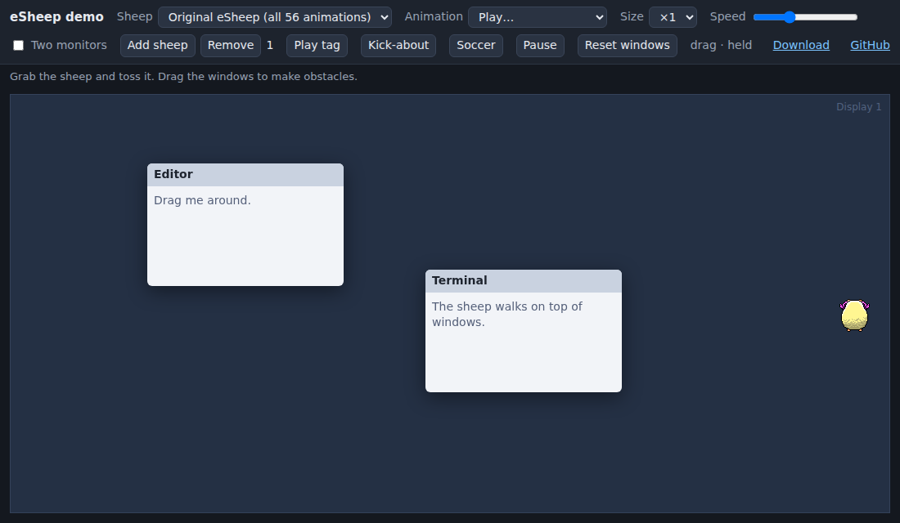

# eSheep

A modern take on the classic desktop sheep. A small animated sheep wanders around your screen, bounces
off the edges and other windows, and can be **grabbed and tossed** with the mouse. Electron and
TypeScript, with a functional, fully tested core that also powers a
[live demo you can try in your browser](https://milesburton.github.io/esheep/).

<!-- metrics:start -->

[](https://github.com/milesburton/esheep/actions/workflows/ci.yml)
[](LICENSE)
[](https://github.com/milesburton/esheep/actions/workflows/ci.yml)
[](https://github.com/milesburton/esheep/actions/workflows/ci.yml)
[](https://github.com/milesburton/esheep/actions/workflows/ci.yml)
[](https://github.com/milesburton/esheep/actions/workflows/ci.yml)

[](https://milesburton.github.io/esheep/)

<!-- metrics:end -->

<!-- screenshots:start -->

<figure>
  
  <figcaption>The live demo: a sheep that walks, falls, sleeps and lands on windows.</figcaption>
</figure>

<figure>
  
  <figcaption>Grab the sheep with the mouse...</figcaption>
</figure>

<figure>
  
  <figcaption>...and it wanders across multiple monitors.</figcaption>
</figure>

<figure>
  
  <figcaption>The desktop app's settings window.</figcaption>
</figure>

<!-- screenshots:end -->

## Try it

**[Open the live demo](https://milesburton.github.io/esheep/)**: a fake desktop with draggable
windows and an optional second monitor. Grab the sheep, fling it, and watch it land on a window.

## Features

- Transparent, always-on-top, click-through window (128 × 128 px) that only catches the mouse over the
  sheep's own pixels.
- **Grab and toss**: pick the sheep up, drop it, or flick it. A throw uses your pointer's recent
  velocity, then the sheep tumbles, bounces off walls, windows and floors, and lands (harder throws
  land harder).
- **Multi-monitor**: the walkable area is the union of every display; the sheep crosses between them.
- **Window collisions** on Windows (via `node-window-manager`): the sheep walks on top of windows and
  bounces off their sides. macOS and Linux fall back to screen edges only (see below).
- **Sprite packs**: two bundled, plus any desktopPet/eSheep-format `animations.xml`.
- **A flock**: run 1 to 12 sheep at once (one transparent window each). Add and remove them from the
  tray or Settings, or with the demo's Add sheep button.
- Tray menu (Pause / Resume, Add / Remove sheep, Settings…, Quit), persisted preferences (speed,
  sound, pack, sheep count) and start-at-login.

## Run it

Requires Node 22 or newer.

```bash
npm install
npm run dev          # compile and launch the desktop app
npm run demo         # build and serve the browser demo on http://localhost:4173
```

| Command                   | What it does                                         |
| :------------------------ | :--------------------------------------------------- |
| `npm run build`           | Compile and package installers with electron-builder |
| `npm test`                | Unit tests (Vitest)                                  |
| `npm run test:coverage`   | Unit tests with coverage thresholds                  |
| `npm run test:e2e`        | Playwright: browser demo, plus the real app (below)  |
| `npm run lint` / `format` | ESLint / Prettier                                    |
| `npm run readme`          | Refresh the pills and screenshots above from reports |
| `npm run fetch-original`  | Download the classic sheep for **personal use** only |

The Electron end-to-end tests need a display. On a headless Linux box run them under Xvfb:
`xvfb-run -a npx playwright test --project=electron`. If your shell sets `ELECTRON_RUN_AS_NODE`
(some editors do), unset it first.

## Using it

- **Tray icon**: Pause / Resume, Add sheep, Remove sheep, Settings…, Quit.
- **Grab**: press on the sheep and hold. It dangles. Move to carry it.
- **Drop**: release while the pointer is still, and it falls under gravity.
- **Toss**: release mid-flick. Throw speed is capped at 3,200 px/s.
- **Settings**: speed (0.5 to 2×), sound, which sprite pack to use, and how many sheep.

> **Linux:** grabbing is unavailable because Electron cannot forward mouse-move events through a
> click-through window there. The sheep still wanders; it just cannot be picked up. The browser demo
> works everywhere.

## Sprite packs

| Pack      | Behaviour                                                                                                                                                                          |
| :-------- | :--------------------------------------------------------------------------------------------------------------------------------------------------------------------------------- |
| `builtin` | The original brief: a sheep that drifts in straight lines and bounces.                                                                                                             |
| `woolly`  | A classic-style sheep using all 56 classic animations: it walks, turns, sleeps, wees, grazes, climbs walls, walks the ceiling, hops onto windows, takes a bath, falls and tumbles. |

Both are generated by [`scripts/make-assets.mjs`](scripts/make-assets.mjs) and are original work under
the MIT licence. Drop another pack into `assets/packs/<name>/animations.xml` (the desktopPet format:
tile sheet, probability-weighted transitions, `border` and `gravity` hooks) and choose it in Settings.

### The original eSheep art

See it in the demo on your own machine with `npm run fetch-original && npm run demo:original`; that
build adds an "Original eSheep (local only)" option. The public demo never includes it. Every classic
pack, original or generated, is livened up at load time by [`src/main/tune.ts`](src/main/tune.ts)
(faster tempo and stride, tuned transition weights).

`npm run fetch-original` downloads the classic `esheep64` pack from
[Adrianotiger/desktopPet](https://github.com/Adrianotiger/desktopPet) into `assets/packs/original/`.
That project's code is MIT, but the sheep artwork is Tatsutoshi Nomura's character for Fuji Television
and has no clear licence. It is for **personal use only**: the folder is git-ignored, excluded from
installers, and never part of the demo.

## How it works

```text
src/core      pure, immutable logic: seeded rng, expression evaluator, geometry, physics,
              pointer/throw velocity, the bounce sheep, and the pack animation engine
src/web       thin DOM shell shared by app and demo: Stage (drag, throw, draw), sprites, sound
src/app       Electron renderer (sheep window and settings page)
src/demo      the GitHub Pages demo
src/main      Electron main: window, tray, prefs, pack parsing, window enumeration, auto-launch
src/preload   the narrow contextBridge API (no Node in the renderer)
```

The core has no DOM, Electron or clock access: time, the world and the random seed go in, a new state
comes out. That is what makes it deterministic, easy to test exhaustively, and reusable by the demo.
See [docs/architecture.md](docs/architecture.md) and [docs/decisions.md](docs/decisions.md).

## Testing

- **Unit** (Vitest): the core, pack parsing, window filtering, the stage and the README tooling, with
  coverage thresholds enforced in CI.
- **End to end** (Playwright): the built demo in Chromium (grab, toss, landing on windows, two
  monitors, pause, speed) and the real Electron app under Xvfb (window flags, API surface, tray menu,
  settings persistence, pack switching, grabbing).
- **Soak**: `npm run sim` runs the engine headlessly over many spawns across two monitors.

## The README updates itself

On every push to `main`, CI runs all suites, regenerates the screenshots from the built demo, and runs
`npm run readme`, which rewrites the pills and gallery above (and `docs/badges/*.json`) from the real
test and coverage reports. A bot commit pushes the result. Nothing in those blocks is edited by hand.

## Known gaps

- macOS and Linux have no window enumeration yet (a native addon using `CGWindowListCopyWindowInfo`
  with Screen Recording permission on macOS; EWMH on X11; Wayland exposes no global geometry).
- Windows reports window bounds in physical pixels; high-DPI scaling is not converted yet.
- Mixed-DPI multi-monitor positioning can drift (an Electron limitation).
- Packaging (`npm run build`) is configured for NSIS, DMG and AppImage but has only been exercised
  through the manual **Package** workflow.

## Licence

[MIT](LICENSE)
